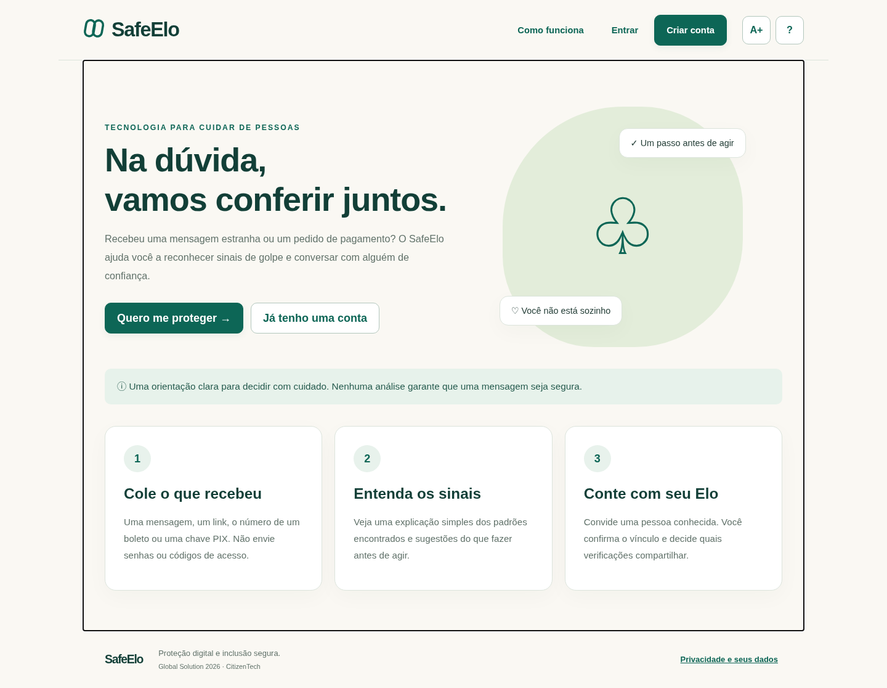
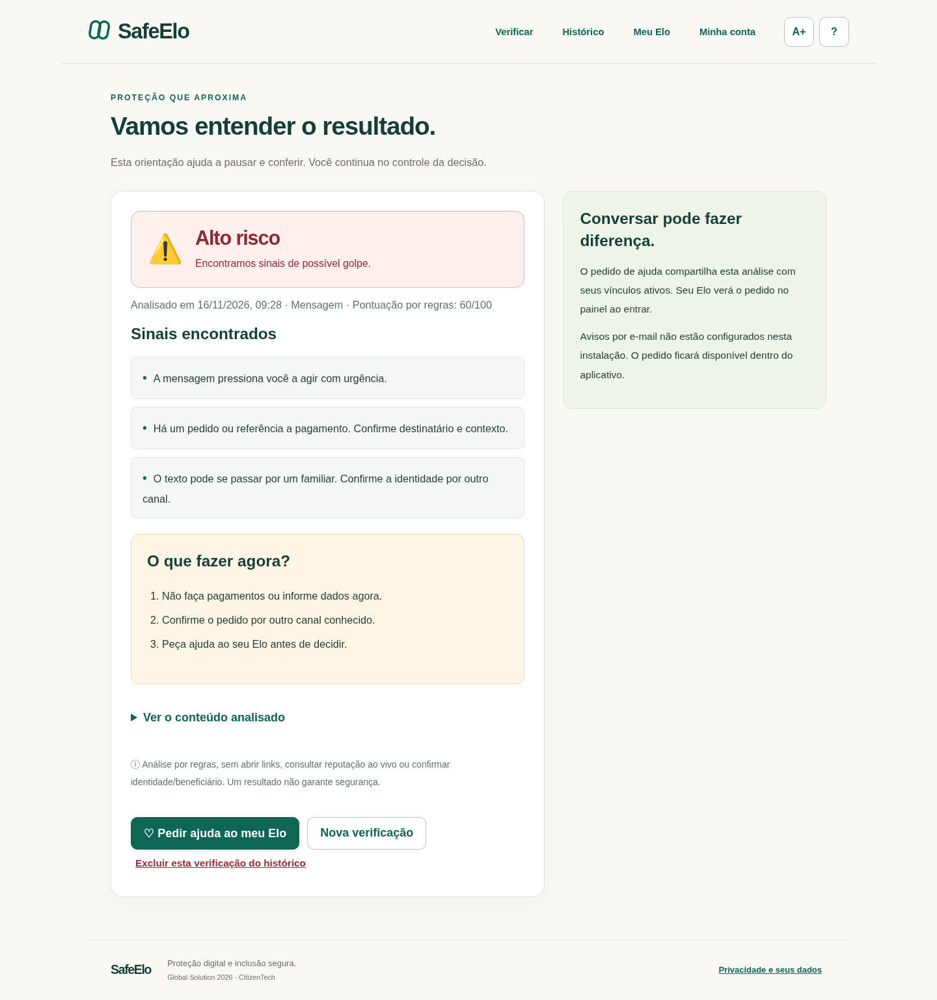
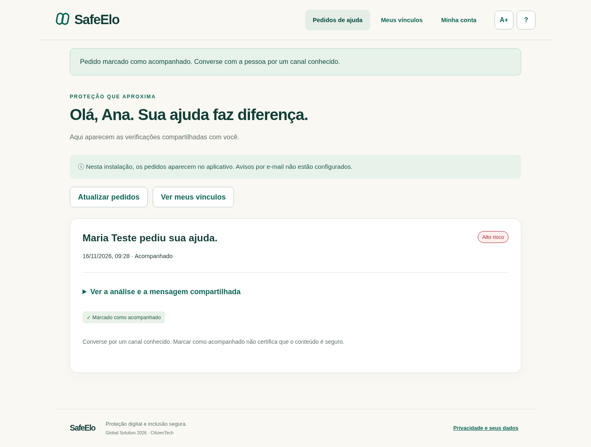
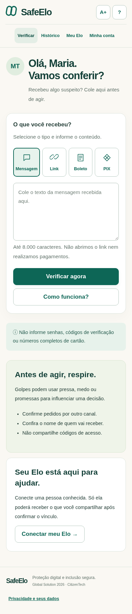

# SafeElo — proteção digital e inclusão segura

Projeto CitizenTech para Global Solution 2026 (FIAP, turma 2SIOA). Foco: idosos, pessoas em digitalização e cidadãos com menor letramento tecnológico. O conceito e o escopo seguem a documentação inicial fornecida para o projeto.

**Aplicação independente:** frontend HTML/CSS/JavaScript, backend Java 17/Spring Boot, autenticação própria e banco relacional. Não requer ChatGPT, OpenAI, login de desenvolvedor ou hospedagem vinculada a esta conversa. Não há resultados pré-gravados ou contas fictícias no produto.

## Documentação em Word e PDF

- [Documentação completa em PDF](documentacao/Documentacao-SafeElo.pdf)
- [Documentação editável em Word](documentacao/Documentacao-SafeElo.docx)

Inclui funcionamento, requisitos, arquitetura, banco de dados, segurança, capturas, execução no Windows/Linux, testes, API e limitações.

## Slides da apresentação

- [PowerPoint editável — 13 slides](apresentacao/SafeElo-apresentacao.pptx)
- [PDF para visualizar e apresentar](apresentacao/SafeElo-apresentacao.pdf)
- [Roteiro de fala e referências](apresentacao/roteiro-de-fala.md)

Os slides incluem capturas reais, proposta de contribuição aos ODS 10 e 16, arquitetura, modelo relacional, segurança e testes. As notas de fala também estão dentro do PowerPoint.

## Visualizar sem instalar

As imagens abaixo foram capturadas no sistema real em execução, durante testes com contas e mensagens fictícias. Os resultados foram calculados pelo backend Java e salvos em banco. As funções correspondentes são executadas pela aplicação.

### Página inicial



### Resultado explicado



### Painel do familiar



### No celular



## Baixar e abrir no navegador

[**Baixar pacote completo com executável Java (.zip)**](https://github.com/gabrielhenrik0704-dot/SafeElo/raw/refs/heads/main/distribuicao/SafeElo-1.0.0-completo.zip)

[Conferir SHA-256 do pacote](distribuicao/SHA256SUMS).

Para visualizar o código e estas imagens, basta este repositório. Para **usar as funções interativas**, baixe e extraia o ZIP, tenha Java 17+ instalado e execute o launcher abaixo. Ele inicia um servidor local no próprio computador; não exige contratar ou publicar hospedagem na internet.

No Linux/macOS:

```sh
cd SafeElo
chmod +x scripts/run-local.sh
./scripts/run-local.sh
```

Abra **http://localhost:8080** no navegador do mesmo computador. No Windows, siga a seção de execução PowerShell abaixo. As funções interativas precisam do processo Java local; o GitHub oferece a consulta aos arquivos e à documentação.

O pacote inclui fonte, JAR compilado, migração SQL, documentação e testes; não inclui banco de teste, chaves locais ou credenciais. Quem clonar apenas o código pelo Git poderá compilar com `./mvnw package`.

## O que está implementado

- Cadastro de cidadão e familiar, login, logout, recuperação de senha via SMTP e exclusão de conta.
- Sessão própria com cookie HttpOnly, CSRF, BCrypt custo 12, restrições de perfil e propriedade no backend.
- Verificação de mensagens, URLs, linha digitável de boleto e formatos comuns de chave PIX.
- Motor Java que lê regras persistidas, calcula pontuação e apresenta sinais, recomendações e limites. Não é inteligência artificial nem reputação ao vivo.
- Histórico persistente, consulta de detalhes e exclusão de verificações.
- Convite privado, aceite do familiar, confirmação pelo cidadão, vínculo ativo e revogação.
- Pedidos de ajuda reais no painel do familiar, acompanhamento e compartilhamento automático de alto risco mediante escolha prévia.
- Aviso opcional por e-mail. Sem SMTP, o painel interno funciona e a interface avisa que o e-mail está indisponível. Recuperação de senha retorna indisponibilidade, sem simular envio.
- AES-256-GCM para o conteúdo das verificações e telefone no banco; chave fora do banco. Não é criptografia ponta a ponta: o servidor processa os dados.
- Layout responsivo e acessível: texto ampliável, foco visível, botões grandes, formulários rotulados, alertas por texto/ícone/cor e navegação por teclado.
- Migração Flyway compatível com H2 e PostgreSQL, testes de API e de navegador real.

## Executar rapidamente

Requisito: **Java 17 ou superior**. O pacote de entrega contém `target/safeelo-1.0.0.jar`, já compilado.

No Linux/macOS:

```sh
chmod +x scripts/run-local.sh
./scripts/run-local.sh
```

Abra **http://localhost:8080**. Crie suas contas; não existe usuário ou senha padrão.

O script gera uma chave exclusiva em `.local/server-key`, com permissão restrita. O H2 persiste em `.local/db/`. **Não perca a chave:** sem ela não é possível decifrar conteúdo e telefones já armazenados. O script recusa gerar outra chave se encontrar um banco existente sem a original. Nunca envie a chave pelo chat ou pelo Git.

Para outra porta:

```sh
PORT=8090 ./scripts/run-local.sh
```

No Windows/PowerShell, para executar o JAR diretamente:

```powershell
New-Item -ItemType Directory -Force .local | Out-Null
if (!(Test-Path .local/server-key)) {
  $safeeloKeyBytes = New-Object byte[] 32
  $safeeloRng = [System.Security.Cryptography.RandomNumberGenerator]::Create()
  $safeeloRng.GetBytes($safeeloKeyBytes)
  $safeeloRng.Dispose()
  [Convert]::ToBase64String($safeeloKeyBytes) | Set-Content -Encoding ascii .local/server-key
}
$env:SAFEELO_ENCRYPTION_KEY = (Get-Content .local/server-key).Trim()
java -jar target/safeelo-1.0.0.jar
```

Se o banco já existir e o arquivo de chave estiver ausente, restaure a chave original antes de rodar o trecho acima. Proteja esse arquivo com as permissões da sua conta Windows.

## Compilar a partir do código

Use um **JDK completo 17+**, não apenas JRE. É necessário acesso à internet para baixar as dependências na primeira compilação.

```sh
./mvnw clean package
# ou: mvn clean package
```

O launcher `mvnw` usa Maven instalado, quando disponível; caso contrário, baixa Maven 3.9.11 do repositório oficial e confere SHA-512. Em Windows, utilize Maven instalado ou Docker.

## Fluxo para apresentar

1. Crie uma conta de cidadão e outra de familiar, usando navegadores ou perfis separados.
2. Em **Meu Elo**, o cidadão informa o e-mail do familiar e cria um convite.
3. Copie o endereço e abra no navegador do familiar. Ele entra com o e-mail indicado e aceita.
4. O cidadão confere a identidade por outro canal e confirma o vínculo. Nenhuma análise é compartilhada antes disso.
5. Cole uma mensagem de exercício, por exemplo: “Mãe, faça um PIX agora. É urgente.” Identifique o material como teste na apresentação.
6. Leia os sinais e a classificação. Peça ajuda; o alerta aparece no painel do familiar, que pode marcar como acompanhado.
7. Mostre histórico e revogação. Após revogar, o familiar perde o acesso aos pedidos no aplicativo.

Os exercícios não fazem parte de uma conta demonstrativa pré-carregada: cada resultado é calculado e salvo pelo backend.

## Banco e implantação independente

H2 em arquivo facilita a execução acadêmica. Para PostgreSQL e Docker:

```sh
./scripts/init-deploy.sh
# gera .env com senha e chave aleatórias; não versionar esse arquivo

docker compose up --build -d
```

Abra http://localhost:8080. O PostgreSQL não publica porta externamente; o app publica apenas em loopback. Para domínio público e HTTPS:

1. Disponha de uma VPS com Docker/Compose e domínio próprio.
2. Configure o DNS para o servidor e libere portas 80/443.
3. Informe `DOMAIN=seu-dominio.com.br` no `.env`.
4. Execute:

```sh
docker compose -f compose.yaml -f compose.prod.yaml up --build -d
```

Caddy termina TLS e encaminha ao Java; o perfil `prod` exige origem HTTPS e cookie seguro. Confira o certificado real antes de cadastrar dados sensíveis. Para a entrega acadêmica, a execução local é suficiente. A publicação externa desta seção é opcional e não foi realizada.

`Dockerfile.runtime` permite construir apenas a imagem de execução a partir do JAR já compilado: `docker build -f Dockerfile.runtime -t safeelo .`. O `Dockerfile` normal compila e testa o código em um build multi-stage.

## E-mail e recuperação

Configure no ambiente: SMTP_HOST, SMTP_PORT, SMTP_USER, SMTP_PASSWORD, SMTP_AUTH, SMTP_STARTTLS e MAIL_FROM. Configure APP_BASE_URL com a origem real da aplicação para gerar links de recuperação corretos.

SMTP deve usar autenticação e TLS em produção. Os avisos não incluem conteúdo analisado; encaminham ao painel autenticado. Aceite SMTP não garante entrega à caixa de entrada. Falhas de e-mail não apagam o pedido interno. Não há fila durável de tentativas de e-mail ou integração com WhatsApp/SMS/push nesta versão.

## Testes

```sh
./mvnw test
```

Os testes de integração verificam autenticação/CSRF, isolamento de usuários, fluxo de vínculo, compartilhamento explícito e automático, revogação, cifragem, exclusão, reset de senha e invalidação de sessões. Usam H2 em memória e uma chave de teste pública apenas no código de testes.

Para o fluxo de navegador, com servidor de testes ativo, Python + Playwright + Chromium:

```sh
SAFEELO_TEST_URL=http://127.0.0.1:8080 python3 tests/browser_flow.py
```

O script cria contas temporárias, exercita a interface e exclui as contas ao concluir. Não execute contra produção ou uma instalação com dados reais. O caminho do Chromium é `/usr/bin/chromium`; adapte para seu ambiente. Screenshots ficam no diretório SAFEELO_SCREENSHOTS (padrão `tests/artifacts`, ignorado no Git).

## Limites importantes

- “Sem sinais comuns” não significa “seguro”. As regras geram falsos positivos e falsos negativos; a pontuação não é probabilidade estatística.
- URLs não são abertas e não há reputação em tempo real. Não há OCR, antivírus ou análise de anexos.
- Boleto bancário de 47 dígitos recebe checagem matemática; arrecadação de 48 dígitos só recebe reconhecimento de formato. Não se confirma cobrança ou beneficiário.
- PIX recebe checagem de formato, sem consulta ao DICT/Banco Central, validação matemática de CPF/CNPJ ou validação de PIX copia-e-cola.
- Contas de e-mail não são verificadas automaticamente. Convite privado e confirmação humana do cidadão são obrigatórios antes de compartilhar.
- Nome, e-mail e metadados permanecem legíveis no banco. Conteúdo e telefone são cifrados, mas o servidor detém a chave.
- A segurança foi testada funcionalmente, sem auditoria independente ou certificação. Antes de produção, definir controlador/contato LGPD, base legal, retenção, backup, monitoramento, revisão de dependências e operação de suporte.
- Sessões e limitação de tentativas são locais a uma instância. Múltiplas instâncias exigem sessão compartilhada e proteção de borda.

## Estrutura

`src/main/java/br/com/safeelo`: entidades, repositórios, segurança, motor, serviços e API.

`src/main/resources/static/assets`: interface real servida pelo Java.

`src/main/resources/db/migration`: esquema relacional versionado.

`src/test/java`: testes automatizados de backend.

`tests/browser_flow.py`: testes de interface real.

`docs/ARQUITETURA.md`: decisões, modelo e limites.

`docs/API.md`: contrato HTTP.

`docs/APRESENTACAO.md`: roteiro de validação e relação com os ODS.
